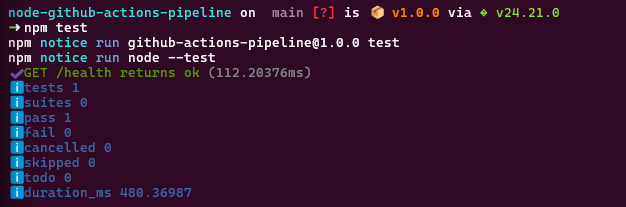
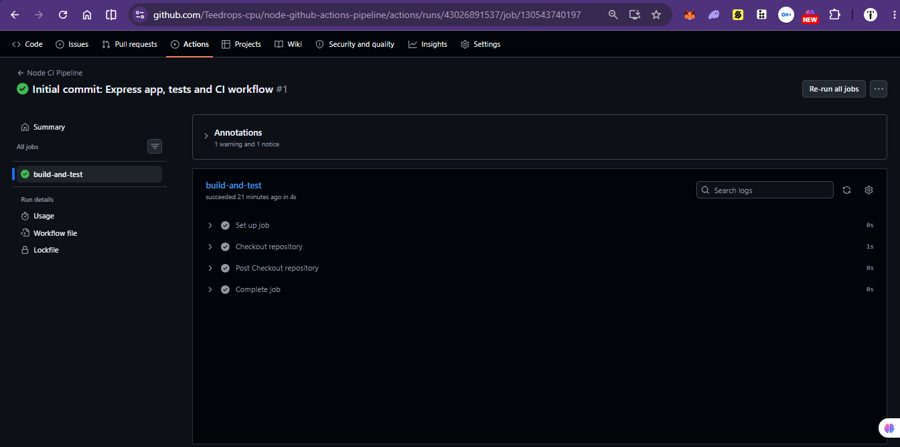
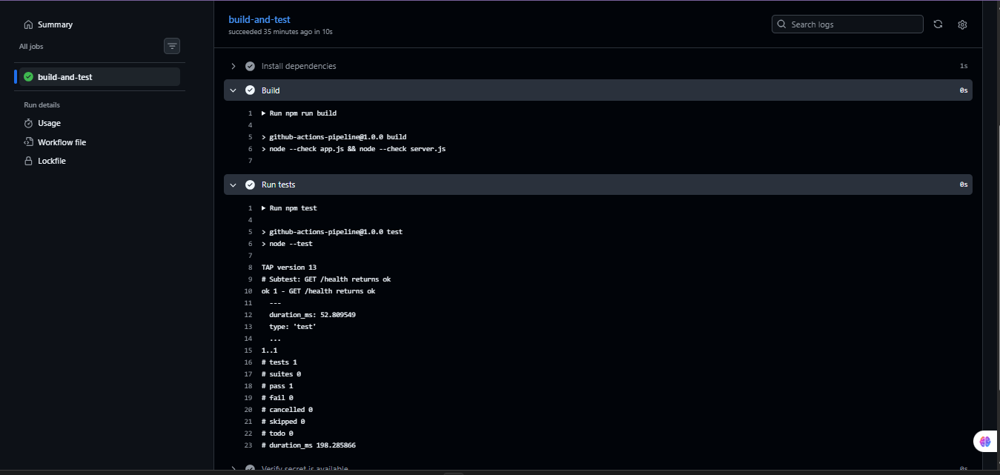
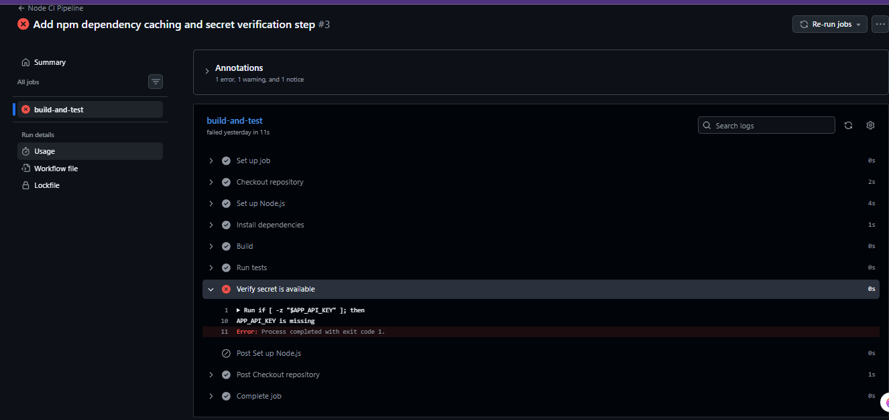
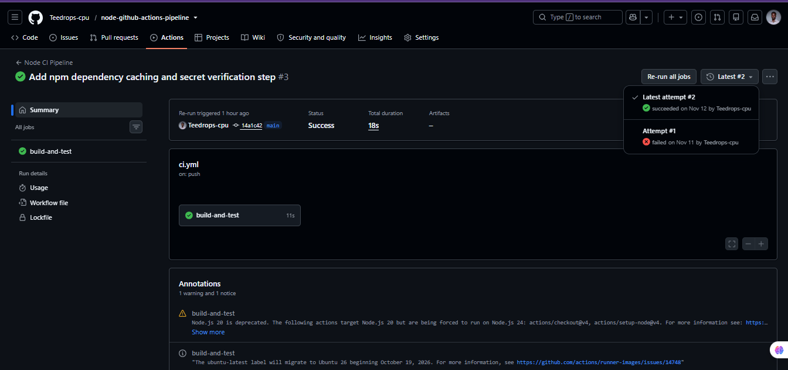
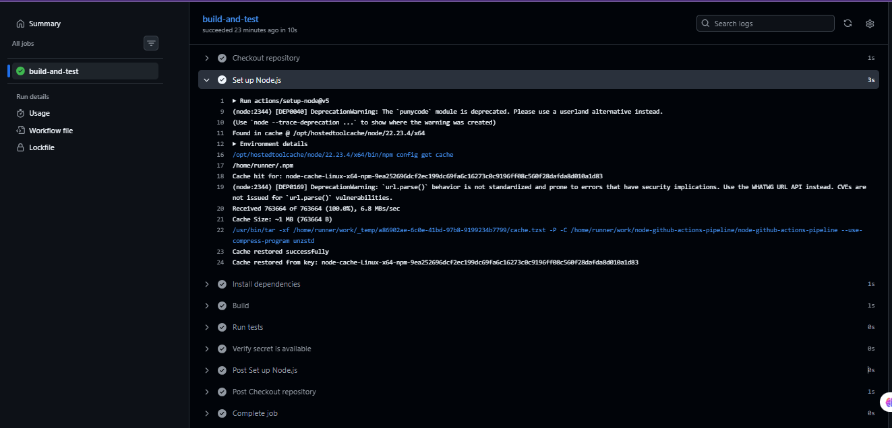
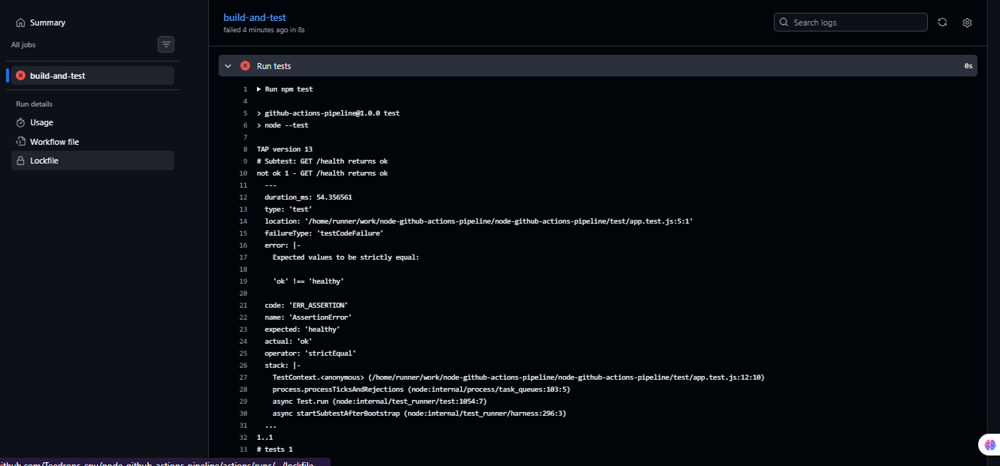
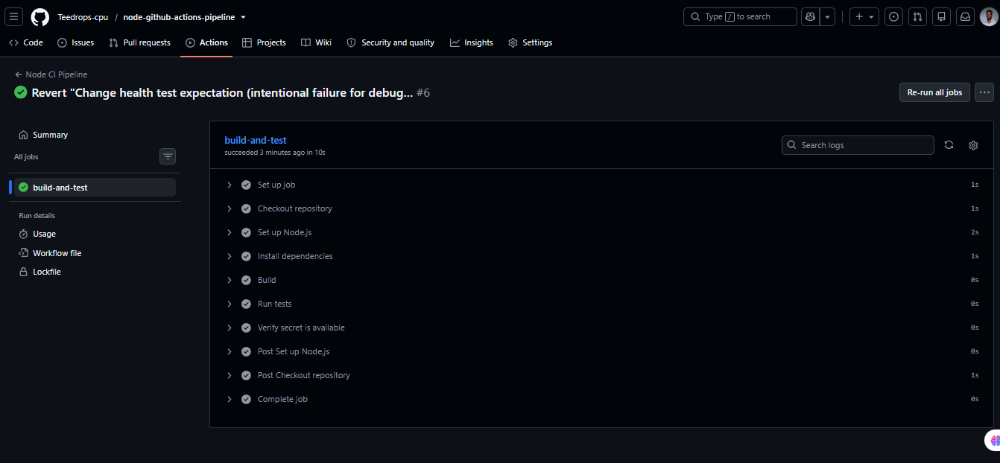
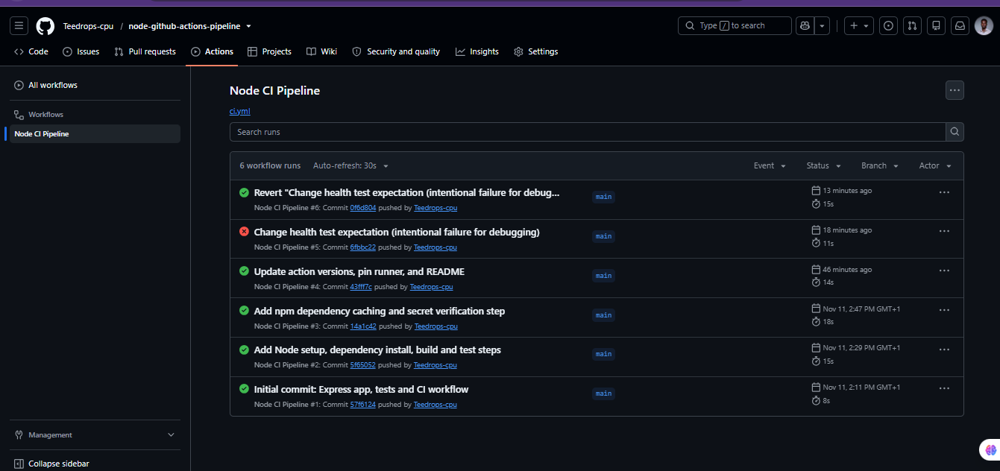

# Node.js CI Pipeline with GitHub Actions


A small Express app with a Continuous Integration pipeline built on GitHub Actions. Every push and pull request to `main` automatically installs dependencies, builds, and tests the code on a fresh virtual machine.

## Project structure

```
.
├── .github/workflows/ci.yml   # The CI pipeline
├── app.js                     # Express app and routes
├── server.js                  # Starts the server
├── test/app.test.js           # Automated test
├── package.json               # Scripts and dependencies
├── package-lock.json          # Pinned dependency versions
└── screenshots/               # Pipeline run evidence
```

## Pipeline overview

The workflow lives in `.github/workflows/ci.yml` and has one job, `build-and-test`.

**Triggers**
- `push` to `main`
- `pull_request` targeting `main`

**Runner:** `ubuntu-24.04`, a fresh GitHub-hosted Ubuntu VM for every run. The version is pinned so builds stay reproducible when `ubuntu-latest` changes.

### Steps

| # | Step | What it does | Why it matters |
|---|------|--------------|----------------|
| 1 | Checkout repository (`actions/checkout@v5`) | Downloads the repo onto the runner | The runner starts empty, so there is no code without this |
| 2 | Set up Node.js (`actions/setup-node@v5`) | Installs Node 22 and enables npm caching (`cache: npm`) | Pins the runtime and speeds up later runs |
| 3 | Install dependencies (`npm ci`) | Installs the exact versions in `package-lock.json` | Clean, repeatable installs; fails if the lockfile and `package.json` disagree |
| 4 | Build (`npm run build`) | Syntax-checks `app.js` and `server.js` with `node --check` | Express has no compile step, so this catches syntax errors early |
| 5 | Run tests (`npm test`) | Runs the tests with Node's built-in test runner | Stops broken code from passing |
| 6 | Verify secret is available | Confirms the `APP_API_KEY` secret is injected, printing only its length | Shows secrets are handled safely |

Steps run in order and the job stops at the first failure, so problems are caught as early and cheaply as possible.

## Security and optimization

- **Secrets:** `APP_API_KEY` is stored under Settings → Secrets and variables → Actions. It is passed through `env:` to only the step that needs it, and its value is never printed or committed.
- **Caching:** `cache: npm` saves npm's download cache between runs, keyed on a hash of `package-lock.json`. The cache is reused until the lockfile changes.

## Run locally

```bash
npm ci
npm run build
npm test
npm start
```
The server runs at `http://localhost:3000`. Routes: `/` and `/health`.

## Screenshots

| Evidence | Screenshot |
|----------|------------|
| Local test passing before the first push |  |
| First run: checkout only |  |
| Full pipeline passing: build and test logs |  |
| Failure: missing secret |  |
| Fixed run after adding the secret |  |
| Cache hit: npm cache restored |  |
| Failure: broken test (expected vs actual) |  |
| Green run after reverting the test |  |
| Full run history: green, red, green |  |

## Troubleshooting log

**1. Push rejected: missing `workflow` scope**
- *Symptom:* `git push` was refused with "without `workflow` scope".
- *Cause:* The Personal Access Token could not create or edit files under `.github/workflows/`.
- *Fix:* Added the `workflow` scope to the token and pushed again.

**2. Run failed: `APP_API_KEY is missing`**
- *Symptom:* Everything passed except "Verify secret is available".
- *Cause:* The repository secret had not been created, so the variable was empty.
- *Fix:* Added `APP_API_KEY` under Settings → Secrets and variables → Actions, then re-ran the jobs.

**3. Annotation warnings (Node.js 20 deprecation, `ubuntu-latest` migration)**
- *Cause:* The v4 actions ran on a deprecated runtime, and `ubuntu-latest` was changing OS versions.
- *Fix:* Upgraded to `checkout@v5` and `setup-node@v5`, moved to Node 22, and pinned `ubuntu-24.04`.

**4. Intentional test failure**
- *Symptom:* "Run tests" failed and later steps were skipped.
- *Cause:* The test expected `"healthy"` but `/health` returns `"ok"`, so the assertion failed.
- *Fix:* Reverted the commit with `git revert`, which kept the failed run visible in history, and the next run passed.
